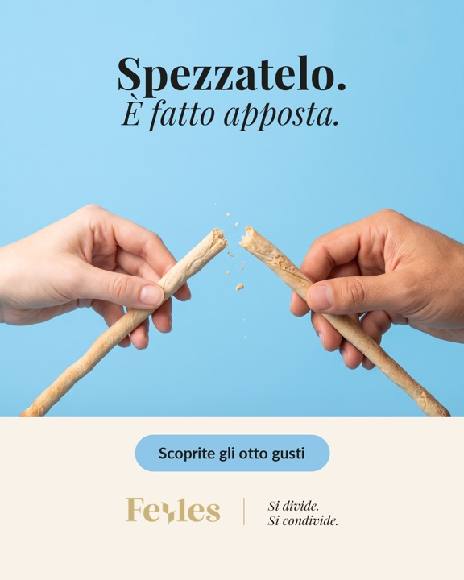
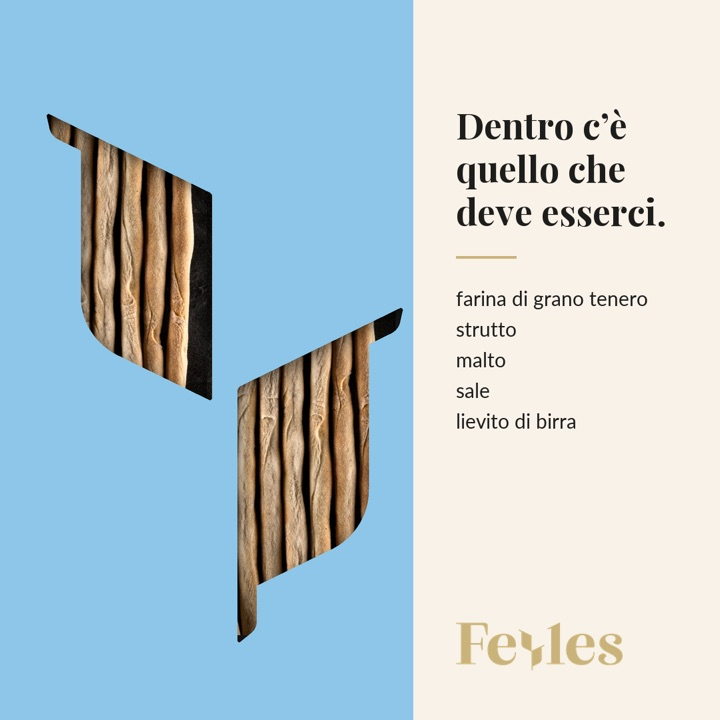
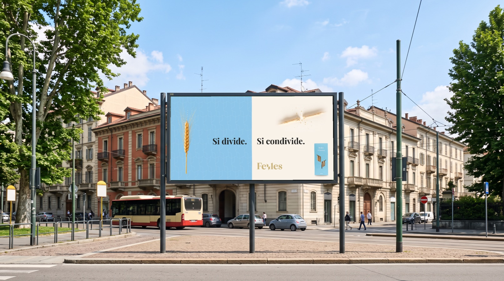
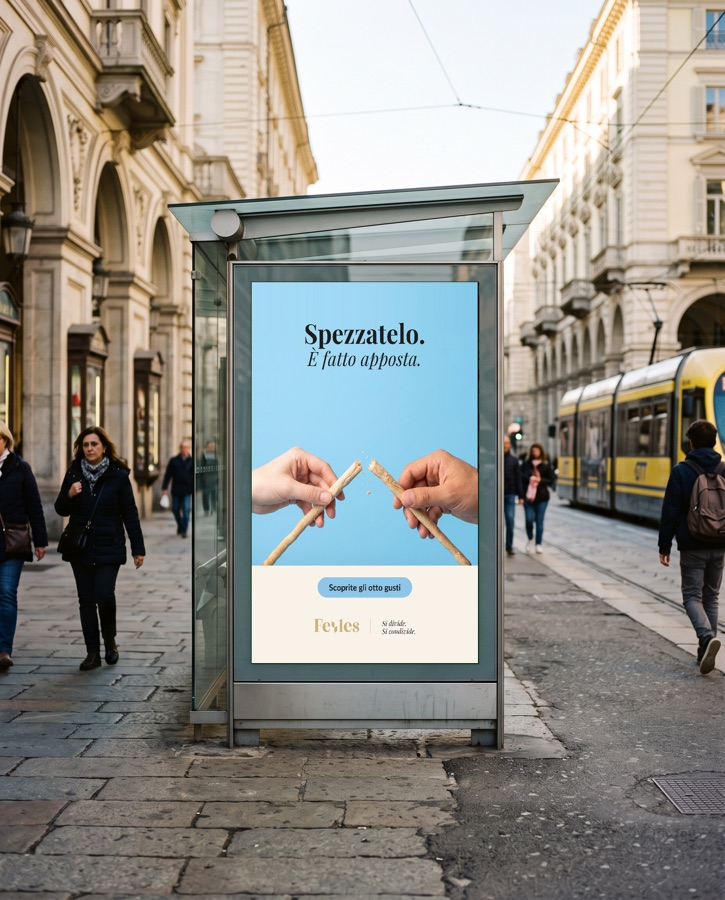

# «Si divide. Si condivide.»: a GenAI campaign for Feyles Rubatà

Entry of the [B-AROL-O team](https://github.com/B-AROL-O) to the [GDG Torino "Build with AI" Agenthon](https://agenthon.gdgtorino.it/) of 21 November 2026, Track 2: GenAI for marketing.

In one working day we designed and produced, almost entirely with generative AI, an advertising campaign for the Rubatà breadsticks of [Grissinificio Feyles](https://grissinificiofeyles.it/), a family bakery near Turin founded in 1968.
The [challenge brief](docs/track2-challenge.md) asked for a commercial, a social media set, web and print visuals, an advertising image, a project sheet and the list of tools used.

## The idea

In Italian, **«dividere»** means two things at once: **to break** and **to share**.
A Rubatà does both in a single gesture: snap one in half, and you are already handing the other half to someone.
So the campaign does not explain sharing; it shows the snap, and the aperitivo begins.

**Claim:** _«Si divide. Si condivide.»_ (It breaks. It's shared.)

The full rationale is in the [project sheet](docs/track2-project-sheet.md), and the creative decisions taken at the 12:00 concept lock are in the [concept lock](docs/track2-concept-lock.md).

## What we delivered

| #   | Deliverable                | What it is                                                                                       | Details                                                                                                            |
| --- | -------------------------- | ------------------------------------------------------------------------------------------------ | ------------------------------------------------------------------------------------------------------------------ |
| 1   | Commercial                 | A spot of about 26 seconds in 8 beats, in 16:9 and 9:16                                          | [Concept lock and beat sheet](docs/track2-concept-lock.md)                                                         |
| 2   | Social media content set   | Five post concepts in 9:16, 4:5 and 1:1, a six-slide carousel and captions                       | [Static visuals catalogue](docs/track2-wp2-deliverables.md), [social copy deck](docs/track2-social-copy-deck.md)   |
| 3   | Web and print visuals      | Web banners, home page hero, display ads, poster, billboard, bus shelter, magazine page, mockups | [Static visuals catalogue](docs/track2-wp2-deliverables.md), [on-image catchphrases](docs/track2-on-image-copy.md) |
| 4   | Advertising image          | Hero ad with headline and call to action, in three formats, plus a range ad                      | [Static visuals catalogue](docs/track2-wp2-deliverables.md)                                                        |
| 5   | Project presentation sheet | Idea, concept, campaign system and the role of AI                                                | [Project sheet](docs/track2-project-sheet.md)                                                                      |
| 6   | Tool details               | Every platform, model and piece of software used, and what for                                   | [Tools list](docs/track2-tools.md)                                                                                 |

The submitted files were handed in through a Google Drive folder, as the organisers required; [deliverables](docs/deliverables.md) maps each deliverable to its folder.

<!-- TODO: replace with the public link to the final spot -->

- **Commercial:** _public link to the spot coming soon_
- **Pitch deck:** [HTML deck](docs/slides/track2-pitch-deck.html) with speaker notes, and a PDF attached to each [release](https://github.com/B-AROL-O/agenthon-2026/releases); see [how to show the pitch deck](docs/howto-show-pitch-deck.md)

| Social post                                                  | Billboard mockup                                          | Bus shelter in Turin                                                 |
| ------------------------------------------------------------ | --------------------------------------------------------- | -------------------------------------------------------------------- |
|  |  |  |

## How we built it

AI made the image plates, the video clips, the voiceover, the music and the sound effects; people made every decision about the idea, the brand and the final cut.

- **Images:** Nano Banana 2 on Vertex AI, with the official pack photos as references, so packs and product stay faithful.
- **Video:** Google Veo 3.1 on Vertex AI, with native audio for the breadstick snaps.
- **Voice and music:** ElevenLabs, with a pronunciation dictionary for Piedmontese words such as «Rubatà».
- **Text and logo:** never generated. Logo, packshots, headlines and calls to action are composited in code with Python and Pillow, so they are exact.
- **Planning, docs and code:** Claude and Claude Code.

The [`genai/`](genai/README.md) folder holds the Python scripts and prompts that generate the plates and composite the static visuals (deliverables 2, 3 and 4).
The complete list of tools and model versions is in the [tools list](docs/track2-tools.md).

## Repository layout

| Path                               | Contents                                                                           |
| ---------------------------------- | ---------------------------------------------------------------------------------- |
| [`docs/`](docs/)                   | The documentation, also browsable as a [Docsify](https://docsify.js.org/) site     |
| [`docs/slides/`](docs/slides/)     | The HTML pitch deck and its images                                                 |
| [`genai/`](genai/)                 | Image generation and compositing pipeline on Vertex AI (Python, managed with `uv`) |
| [`scripts/`](scripts/)             | Helper scripts: deck to PDF, Markdown to PDF, upload to Google Drive               |
| [`video/`](video/)                 | Pack images used while making the commercial                                       |
| [`.devcontainer/`](.devcontainer/) | The [development container](docs/devcontainer.md) the team worked in               |

To preview the docs site locally, run `npx docsify-cli serve docs`.
How the team organised the day (timeline, task split, brainstorm, useful links) is in the [notes from the hackathon day](docs/hackathon-notes.md).

## The Team

| [Team Member](https://www.linkedin.com/)                            | [GitHub](https://github.com/)           | [Hugging Face](https://huggingface.co/)     |
| ------------------------------------------------------------------- | --------------------------------------- | ------------------------------------------- |
| [Alessio Chessa](https://www.linkedin.com/in/alessiochessa/)        | [aleche28](https://github.com/aleche28) | [aleche28](https://huggingface.co/aleche28) |
| [Gianpaolo Macario](https://www.linkedin.com/in/gmacario/)          | [gmacario](https://github.com/gmacario) | [gmacario](https://huggingface.co/gmacario) |
| [Luca Frigato](https://www.linkedin.com/in/luca-frigato-72a64b155/) | [FrigaZzz](https://github.com/FrigaZzz) | [frigazzz](https://huggingface.co/frigazzz) |

## Trademarks

Feyles, Rubatà, Cioccorubatà, Brichet, the Feyles logo and the pack designs are trademarks of Feyles Srl.
They appear in this repository only to document a hackathon entry made for Feyles as the Track 2 client.
This project is not otherwise affiliated with or endorsed by Feyles Srl, and the licenses below do not cover those marks.

## Copyright and license

Copyright (C) 2026, [B-AROL-O Team](https://github.com/B-AROL-O), all rights reserved.

This repository is based on the [python-project-template](https://github.com/arol-polito/python-project-template) template; see [Development container](docs/devcontainer.md) for what it provides.

### Source code license

The source code contained in this repository and the executable distributions are licensed under the terms of the MIT license as detailed in the [LICENSE](LICENSE) file.

### Documentation license

Please note that your contribution to the project Documentation is licensed under a Creative Commons Attribution-Share Alike 4.0 License. see <https://creativecommons.org/licenses/by-sa/4.0/>

<!-- EOF -->
